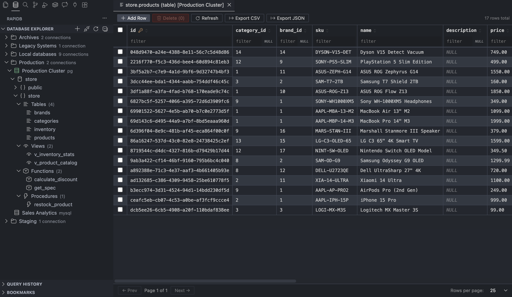
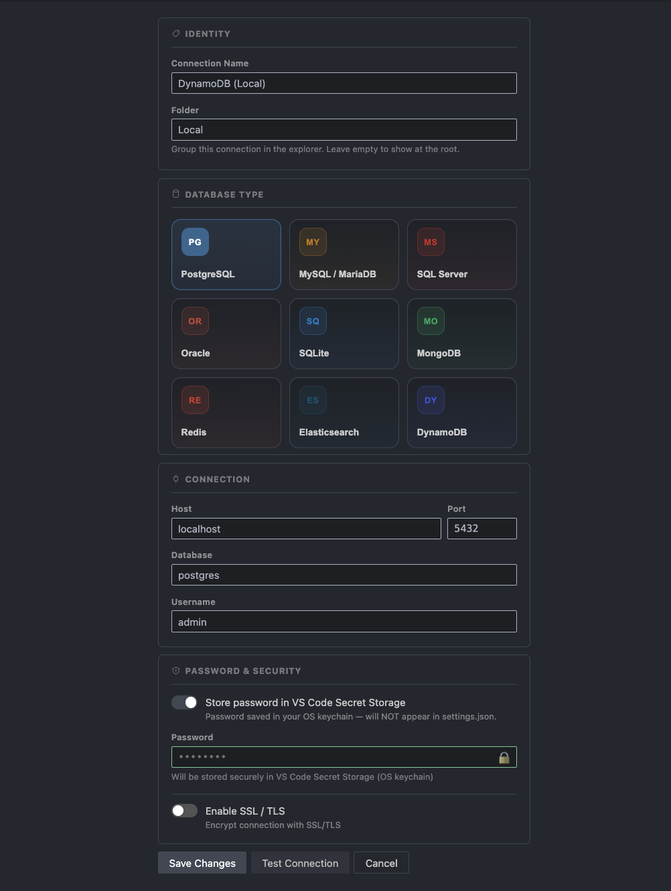
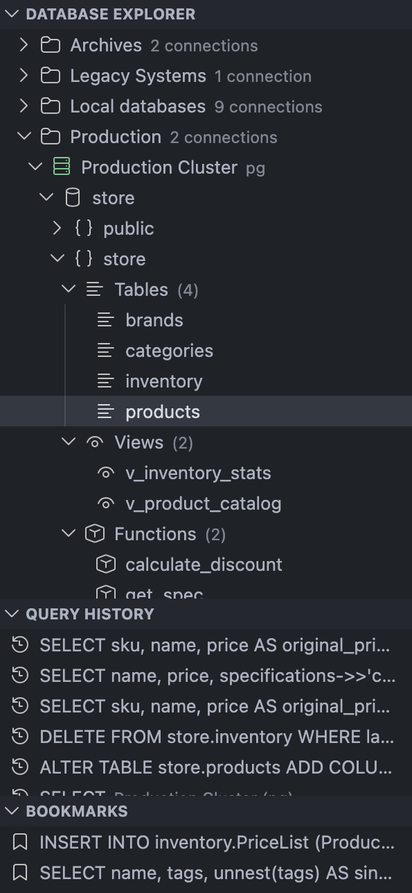
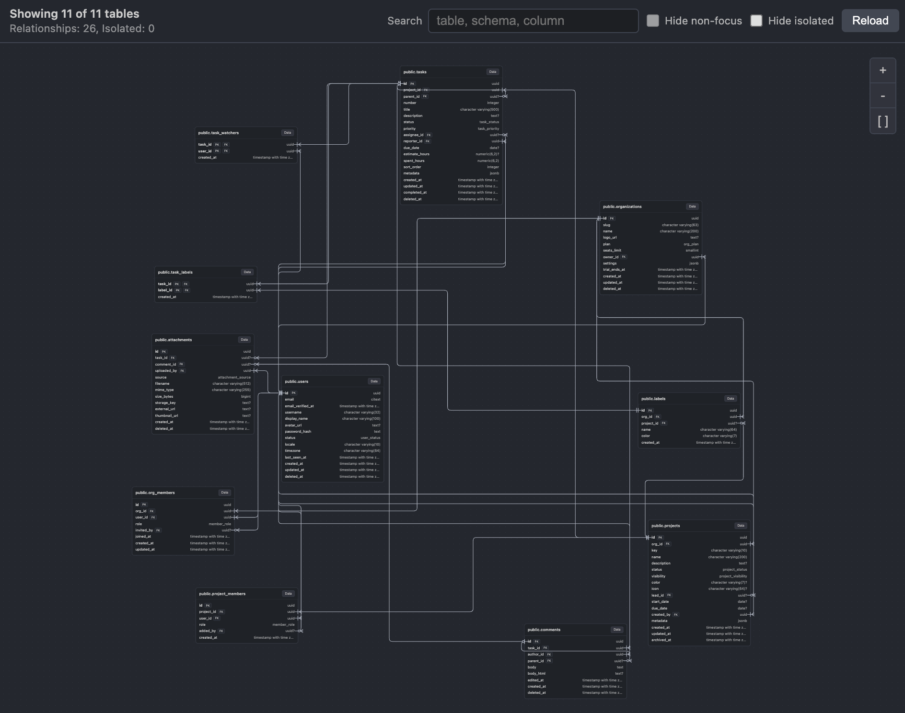
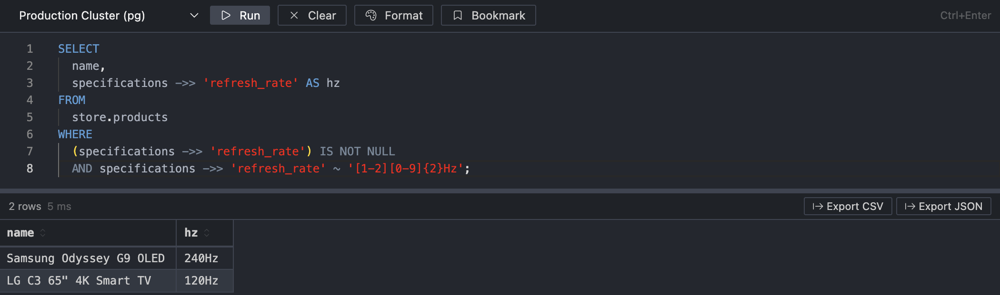
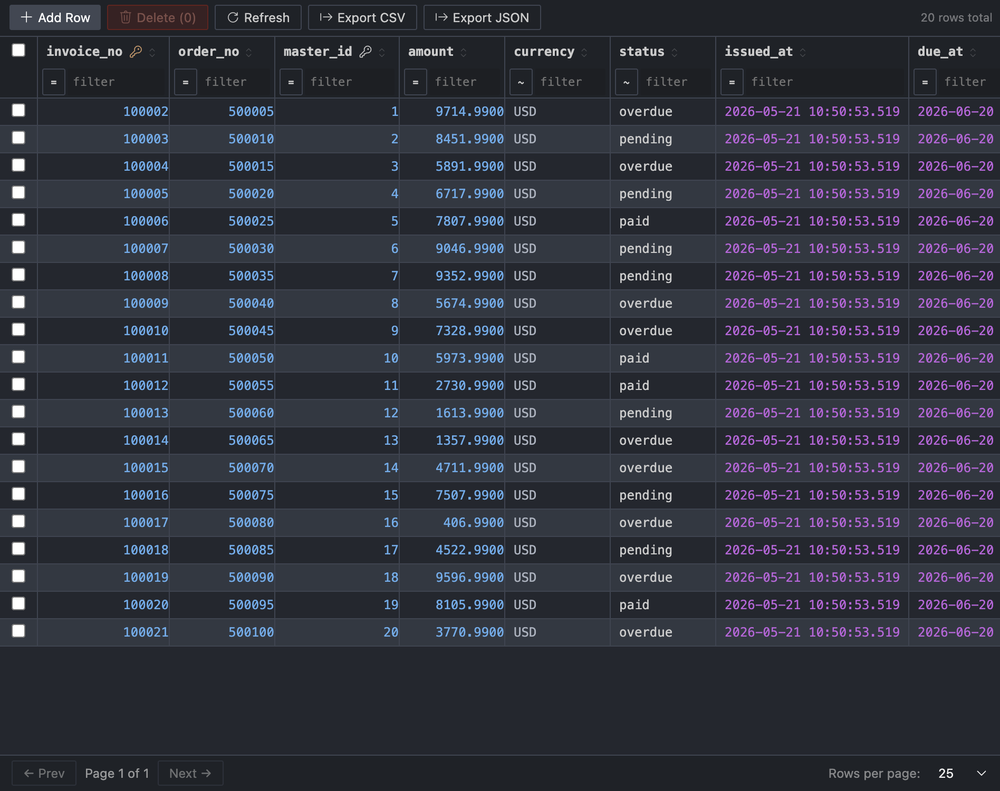

 

 
 

# RapiDB - Database Client for VS Code

### PostgreSQL · MSSQL · MySQL · MariaDB · SQLite · Oracle
### Redis · MongoDB · Elasticsearch · DynamoDB
#### All in one place. Never leaving your editor.

 

 

 

---

*You're deep in the code. Something's off in the data.*
*Now you have to alt-tab to DBeaver, wait for it to wake up,*
*click through five menus...*

**RapiDB kills that context switch.**
Your database lives in the sidebar - same window, same shortcuts, same theme.

---

 

# ⚡ What it actually does

 

### 🔌 Connect to anything

PostgreSQL, MS SQL Server, MySQL, MariaDB, SQLite, Oracle, Redis, MongoDB, Elasticsearch, DynamoDB - all supported out of the box. SSL, self-signed certs, SSH tunneling, connection folders to keep things organized.

> **Read-only mode** blocks table edits and restricts query execution. For SQL Server and Oracle, it allows browsing only; query execution is disabled. Use database-enforced read-only permissions for reliable protection.

> **SSH safety:** run the extension host in a trusted environment, require database authentication, and disconnect unused tunnels. Local processes may access an open SSH forward.

 

### 🌲 Browse your schema without a single query

Group connections into folders and explore databases, schemas, tables, views, materialized views, functions, procedures, sequences, and types. Inspect columns, primary and foreign keys, constraints, indexes, and triggers. Open data or view DDL from the context menu.

Redis keys are grouped by prefix, with separate **All keys** and **Unprefixed keys** views.

 

### 🗂️ Query History & Bookmarks

Reopen previous queries from **Query History**, or save editor text with the **Bookmark** button. Clear saved entries from their view's trash icon.

> Query text may contain sensitive data and is saved without redaction. Set `rapidb.queryHistoryLimit` to `0` to disable history. Bookmarks and editor drafts are stored separately; clearing history does not remove them.

 

### 🧩 ERD with foreign key links

Open ERD from a database or schema node to visualize tables and their foreign key relationships using live schema metadata.

 

### ✏️ A real SQL editor, not a textarea

The query editor runs on **Monaco** - the same engine as VS Code itself. You get:

- 🎨 Syntax highlighting & SQL formatting (button / `Shift+Alt+F`)
- 🧠 Schema-aware autocompletion - knows your actual tables and columns
- ⌨️ `Ctrl+Enter` / `F5` to run · Select a fragment to run just that part
- ↕️ Drag the divider to resize editor vs results

> Finish explicit SQL transactions in the same executed script. After a failed or cancelled write, verify the data before retrying: earlier changes may already have committed.

 

### 📊 Results that stay responsive

Results land in a **virtualized table**:

- Sort by any column · Resize columns · Alternating row stripes
- NULL values are styled differently · Values are colored by types
- Execution time shown right in the toolbar
- **Export to CSV or JSON** in one click

Query results display up to **10,000 rows**, with a warning when truncated. This is a display limit, not a limit on rows affected by a write. Query-result exports include only the displayed rows; use JSON when preserving value types matters.

 

### ✍️ Browse and edit table data

Click any table → the **Table Data Viewer** opens:

| Feature | Detail |
|---|---|
| Pagination | 25 / 100 / 500 / 1000 rows per page |
| Filtering | Draft-aware per-column filters |
| Inline editing | Click a cell → type → Enter |
| New rows | Insert bar at the top |
| Deletion | Select rows and delete |
| Safety | Preview changes before applying; transactional where supported |

Editing support depends on the database engine and column types. Review important changes and keep backups.

 

---

## ⚙️ Settings worth knowing

| Setting | Default | What it does |
|---|---|---|
| `rapidb.connectionTimeoutSeconds` | `15` | Connection timeout in seconds |
| `rapidb.dbOperationTimeoutSeconds` | `180` | Query and database operation timeout in seconds |
| `rapidb.queryRowLimit` | `10000` | Displayed rows per query, up to 10,000 |
| `rapidb.queryHistoryLimit` | `100` | Saved history entries; `0` disables history |
| `rapidb.defaultPageSize` | `25` | Default rows per page in the Table Data Viewer |
| `rapidb.skipTableMutationPreview` | `false` | Apply table edits without the preview dialog |

For database-specific behavior and safety details, see the [usage notes](https://github.com/DmitriiKholkin/RapiDB/blob/main/docs/usage-notes.md).

---

## 🚀 Get started in 4 steps

1. Install the extension.
2. Click the RapiDB icon in the Activity Bar.
3. Hit **Add Connection (+)** and fill in your credentials.
4. Explore, query, and edit.

---

## 💬 Found a bug? Have an idea?

**[⭐ Leave a review in the Marketplace](https://marketplace.visualstudio.com/items?itemName=DmitriiKholkin.rapidb&ssr=false#review-details)** or **[Open VSX](https://open-vsx.org/extension/DmitriiKholkin/rapidb/reviews)** - even a short one helps others decide whether RapiDB fits their workflow and supports the project.

**[🐛 Open an issue on GitHub](https://github.com/DmitriiKholkin/RapiDB/issues)** - include steps to reproduce and the database type.

---

**MIT License** · Made with love and the desire to never alt-tab again

