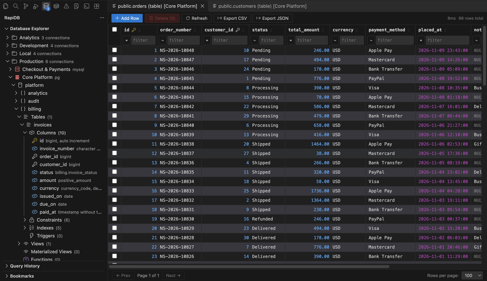
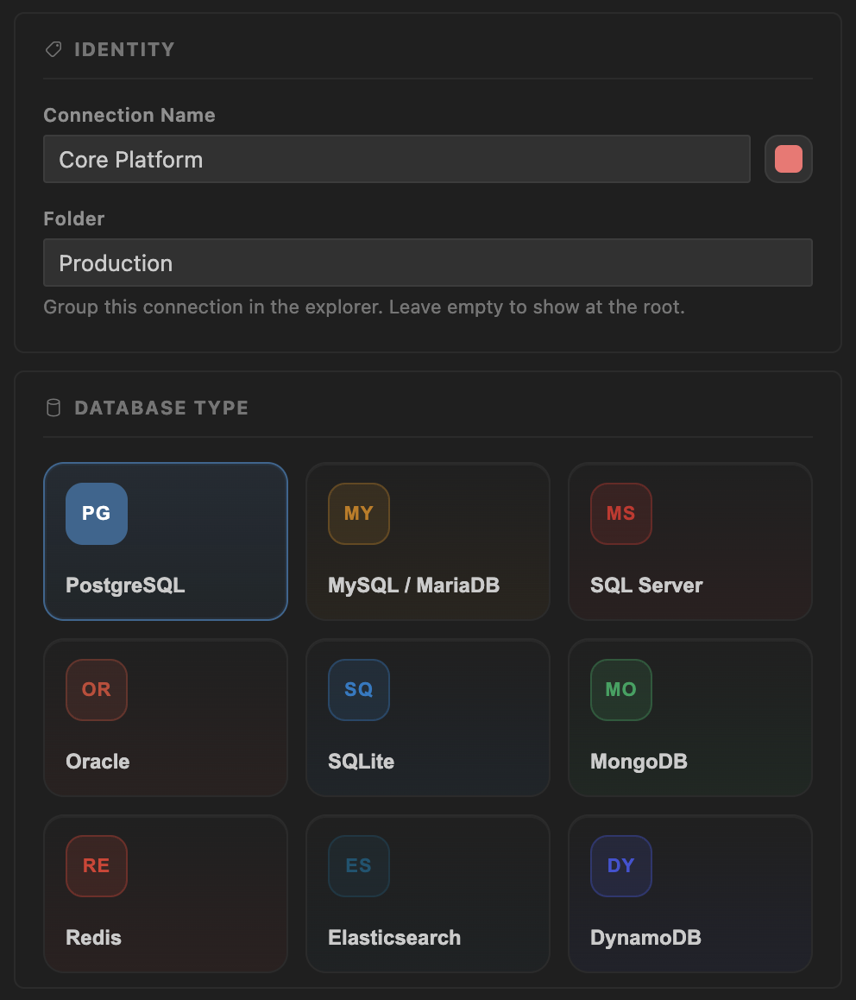
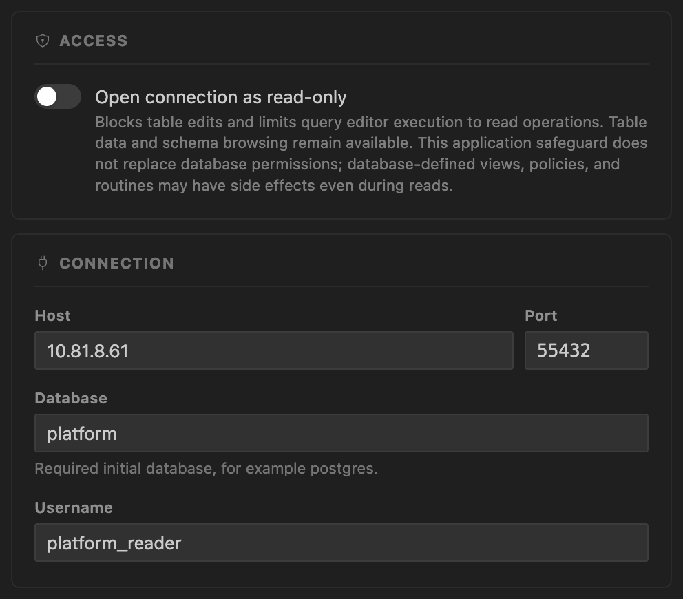
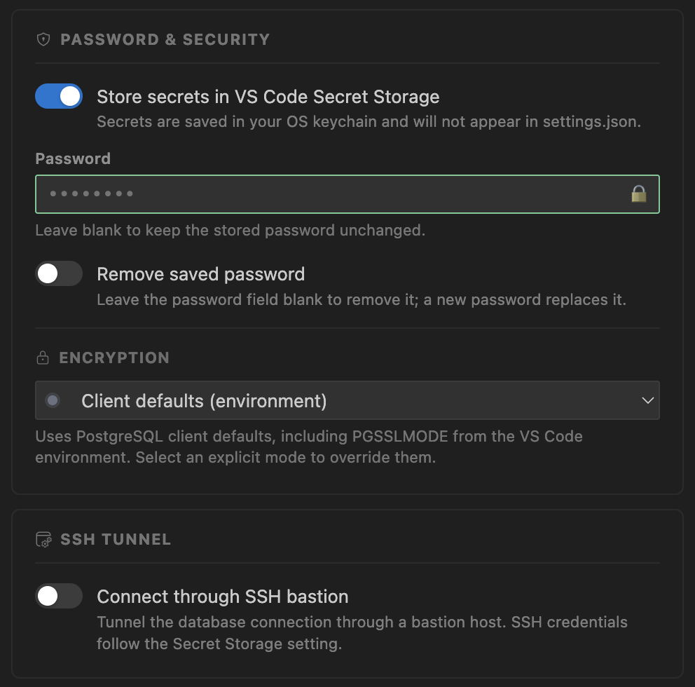
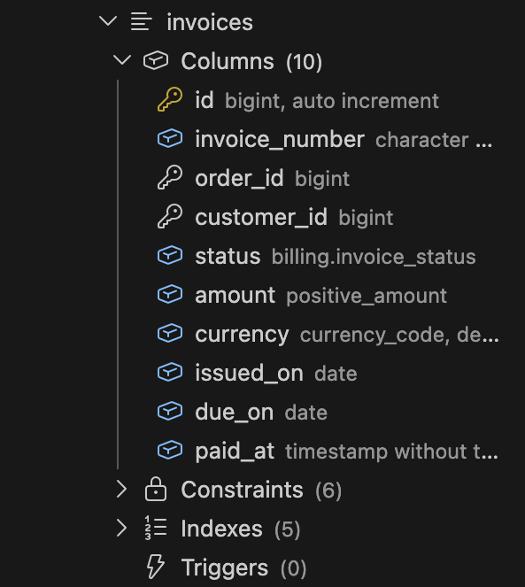
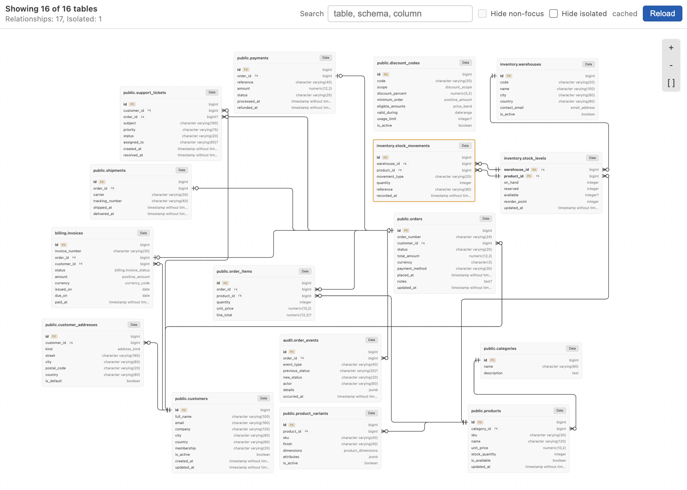
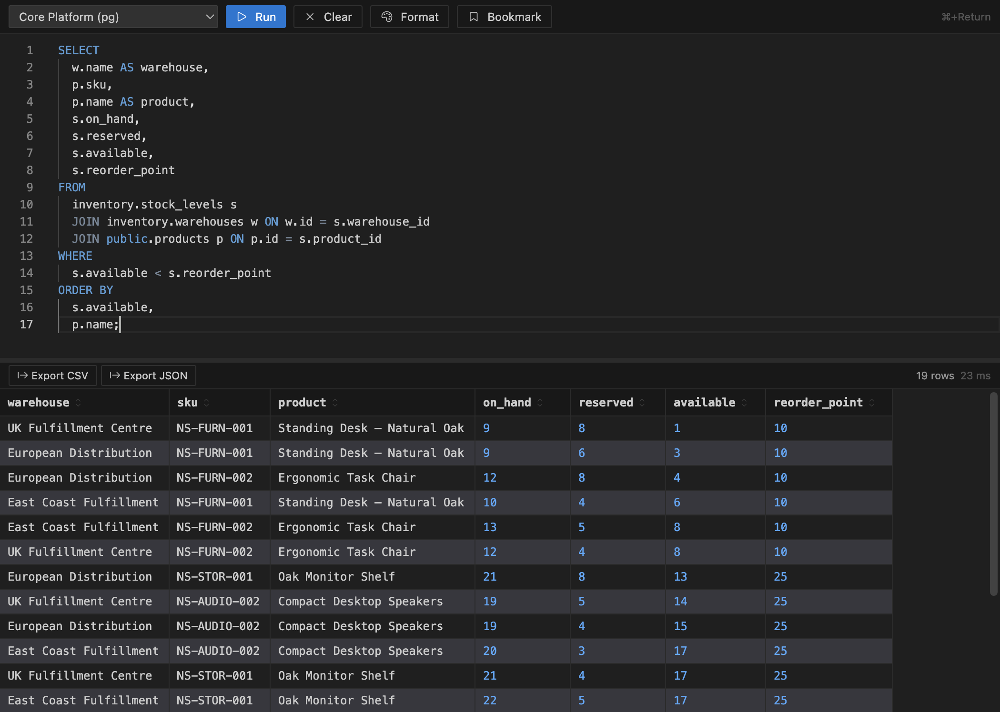
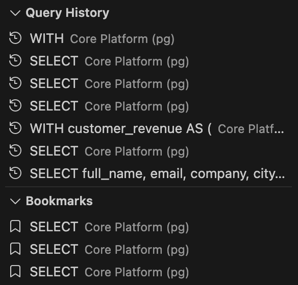
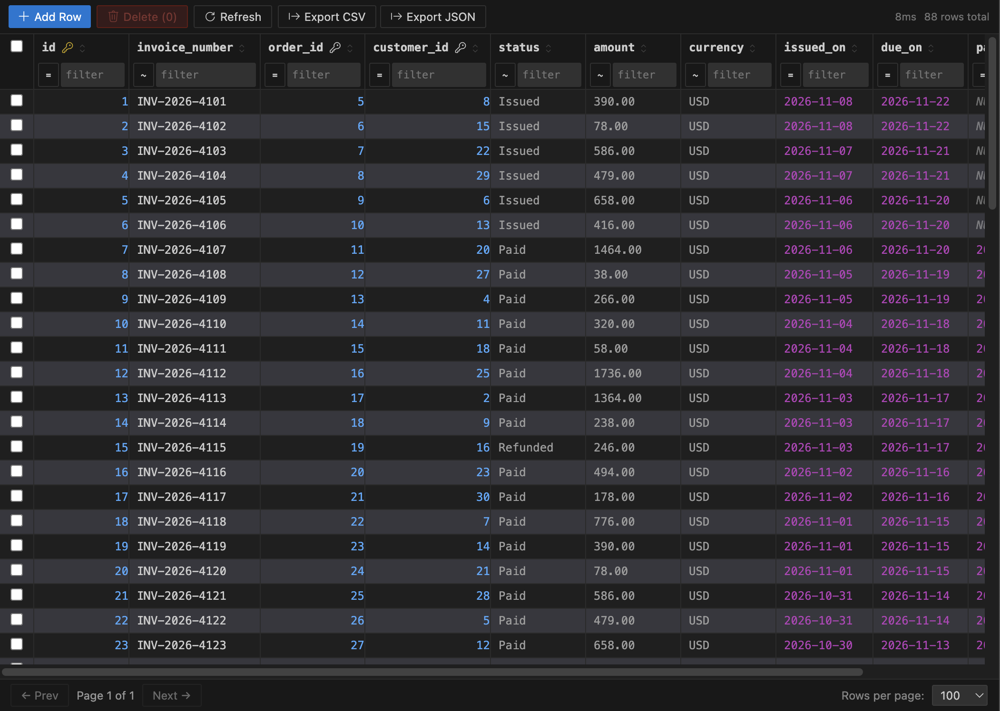

 

# RapiDB - Database Client for VS Code

### PostgreSQL · SQL Server · MySQL · MariaDB · SQLite · Oracle
### Redis · MongoDB · Elasticsearch · DynamoDB
#### All in one place. Never leaving your editor.

 

 

 

---

*You're deep in the code. Something's off in the data.*
*Now you have to alt-tab to DBeaver, wait for it to wake up,*
*click through five menus...*

**RapiDB kills that context switch.**
Your database lives in the sidebar - same window, same shortcuts, same theme.

---

 

# ⚡ What it actually does

 

## 🔌 Connect to anything

PostgreSQL, SQL Server, MySQL, MariaDB, SQLite, Oracle, Redis, MongoDB, Elasticsearch, DynamoDB - all supported out of the box. Pick an engine, give the connection a name and color, and group it into a folder for Production, Staging, or local development.

<table>
  <tr>
    <td width="50%" valign="top">
      
    </td>
    <td width="50%" valign="top">
      
    </td>
  </tr>
</table>

> **Read-only mode** blocks table edits and restricts query execution. For SQL Server and Oracle, it allows browsing only; query execution is disabled. Use database-enforced read-only permissions for reliable protection.

 

## 🔐 Credentials, TLS & SSH

Store credentials with **VS Code Secret Storage**, configure encryption, or connect through an **SSH bastion** - all from the same form.

  

> **SSH safety:** run the extension host in a trusted environment, require database authentication, and disconnect unused tunnels. Local processes may access an open SSH forward.

 

## 🌲 Browse your schema without a single query

Explore databases, schemas, tables, views, materialized views, functions, procedures, sequences, and types. Expand a table to inspect columns, primary and foreign keys, constraints, indexes, and triggers. Open data or view DDL from the context menu.

Redis keys are grouped by prefix, with separate **All keys** and **Unprefixed keys** views.

  

 

## 🧩 ERD with foreign key links

Open ERD from a database or schema node to see how your tables connect - including relationships across schemas. Search by table, schema, or column, zoom into a relationship, and open table data straight from the diagram. RapiDB follows your editor's light or dark theme.

 

## ✏️ Write SQL and see the results

The query editor runs on **Monaco** - the same engine as VS Code itself. You get:

- 🎨 Syntax highlighting & SQL formatting (button / `Shift+Alt+F`)
- 🧠 Schema-aware autocompletion - knows your actual tables and columns
- ⌨️ `Ctrl+Enter` / `Cmd+Enter` or `F5` to run · Select a fragment to run just that part
- ↕️ Drag the divider to resize editor vs results
- 📊 View query results and execution time directly below your SQL
- 📤 Export the displayed results to CSV or JSON

 

## 🗂️ Query History & Bookmarks

Keep useful queries close at hand. **Query History** lets you reopen previous queries with their connection; the editor's **Bookmark** button saves queries you want to reuse.

  

> Query text may contain sensitive data and is saved without redaction. Set `rapidb.queryHistoryLimit` to `0` to disable history. Bookmarks and editor drafts are stored separately; clearing history does not remove them.

 

## ✍️ Browse and edit table data

Open a table to work with your data in a **virtualized grid**. Sort and resize columns, filter individual fields, and distinguish keys, numbers, dates, and NULL values at a glance.

| Feature | Detail |
|---|---|
| Pagination | 25 / 100 / 500 / 1000 rows per page |
| Filtering | Draft-aware per-column filters |
| Inline editing | Click a cell → type → Enter |
| New rows | Insert bar at the top |
| Deletion | Select rows and delete |
| Export | CSV or JSON from the toolbar |
| Safety | Preview changes before applying; transactional where supported |

Editing support depends on the database engine and column types. Review important changes and keep backups.

 

---

## ⚙️ Settings worth knowing

| Setting | Default | What it does |
|---|---|---|
| `rapidb.connectionTimeoutSeconds` | `15` | Connection timeout in seconds |
| `rapidb.dbOperationTimeoutSeconds` | `180` | Query and database operation timeout in seconds |
| `rapidb.queryRowLimit` | `10000` | Displayed rows per query, up to 10,000 |
| `rapidb.queryHistoryLimit` | `100` | Saved history entries; `0` disables history |
| `rapidb.defaultPageSize` | `25` | Default rows per page in the Table Data Viewer |
| `rapidb.skipTableMutationPreview` | `false` | Apply table edits without the preview dialog |

For database-specific behavior and safety details, see the [usage notes](https://github.com/DmitriiKholkin/RapiDB/blob/main/docs/usage-notes.md).

---

## 🚀 Get started in 4 steps

1. Install the extension.
2. Click the RapiDB icon in the Activity Bar.
3. Hit **Add Connection (+)** and fill in your credentials.
4. Explore, query, and edit.

---

## 💬 Found a bug? Have an idea?

**[⭐ Leave a review in the Marketplace](https://marketplace.visualstudio.com/items?itemName=DmitriiKholkin.rapidb&ssr=false#review-details)** or **[Open VSX](https://open-vsx.org/extension/DmitriiKholkin/rapidb/reviews)** - even a short one helps others decide whether RapiDB fits their workflow and supports the project.

**[🐛 Open an issue on GitHub](https://github.com/DmitriiKholkin/RapiDB/issues)** - include steps to reproduce and the database type.

---

**MIT License** · Made with love and the desire to never alt-tab again

